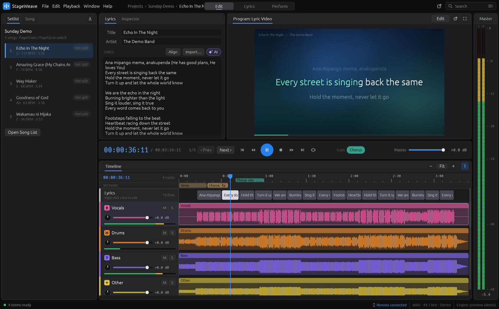
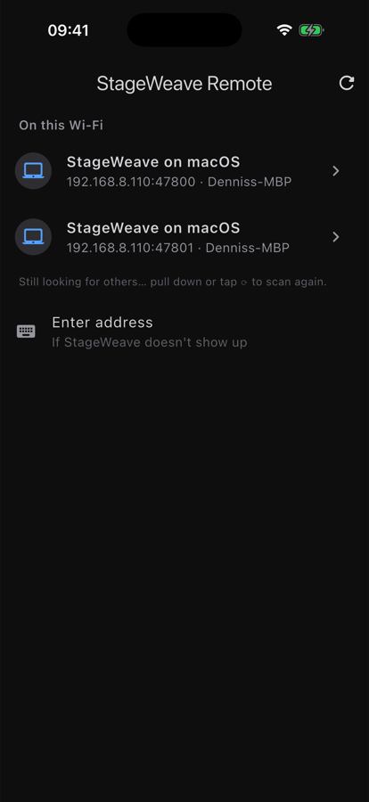
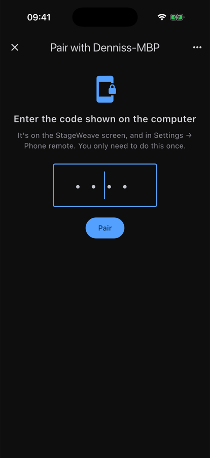
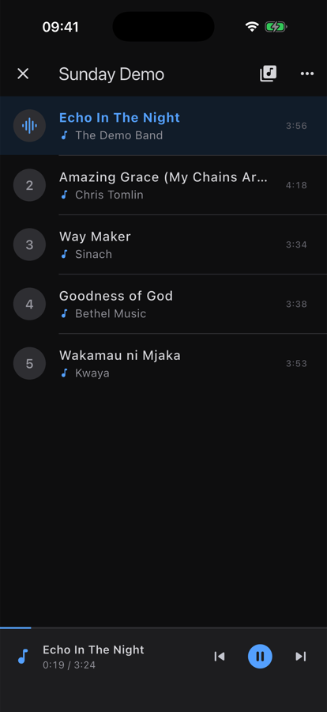
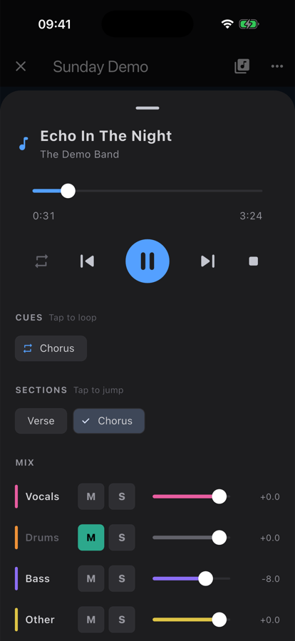
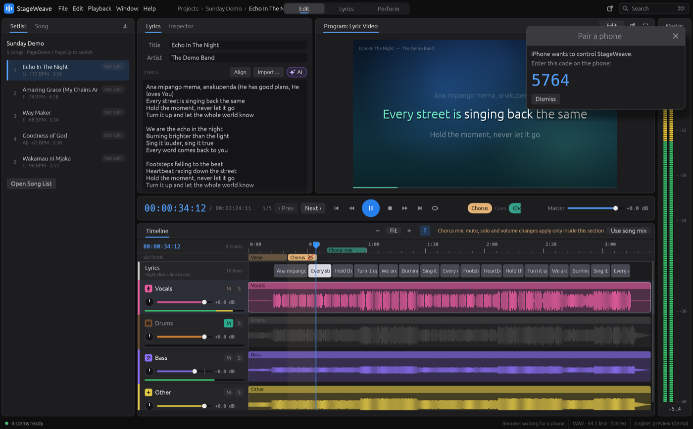

# StageWeave

Stem splitting, live mixing, lyric slides and lyric videos for worship teams and live music, plus a phone remote that runs the show from anywhere on the stage.

| Folder | What's in it |
| --- | --- |
| [`software/`](software) | The StageWeave desktop app for macOS, Windows and Linux (Rust, egui). See [`software/README.md`](software/README.md). |
| [`mobileapp/`](mobileapp) | StageWeave Remote, a phone app for iOS and Android (Flutter) that controls StageWeave over the local Wi-Fi. See [`mobileapp/README.md`](mobileapp/README.md). |

## The desktop app

Split songs into stems, mix them live, align lyrics to the audio, run cues and sections, and project lyric slides or videos. Songs can come from audio files, YouTube links or PowerPoint decks.

## The phone remote

Turn on **Settings → Phone remote** in StageWeave, then open StageWeave Remote on a phone on the same Wi-Fi network. The phone finds the computer by itself. You enter the 4-digit code StageWeave shows the first time, and after that the phone is remembered.

The phone shows titles and controls only, never the media. From it you can:

- open a setlist and load any item;
- play, pause, seek, loop, and go to the previous or next item;
- trigger cues and jump to sections;
- mute, solo and set the level of each stem, plus the master level.

  
  
  
  

When a phone asks to pair, StageWeave shows the code:

The remote is off until you turn it on. It only accepts connections from the local network, and you can remove paired phones in Settings.

## Releases

Pushing a `v*` tag that matches the version in `software/Cargo.toml` builds the desktop installers and the Android APK, and attaches them to a GitHub release. The workflow can also be run by hand from the Actions tab. See [`.github/workflows/release.yml`](.github/workflows/release.yml).
