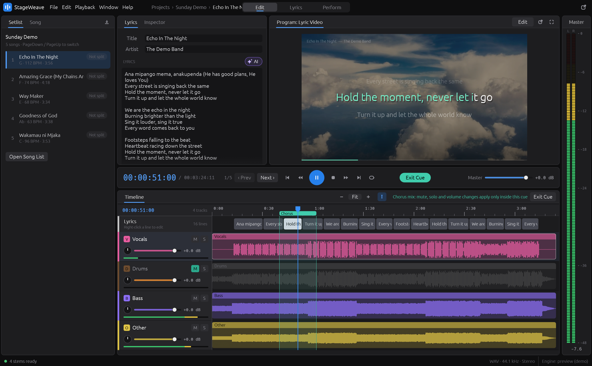
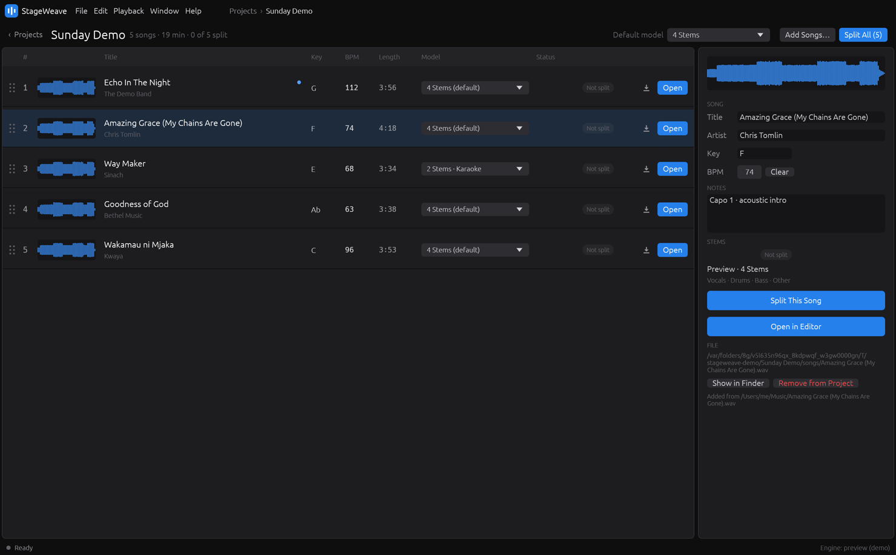
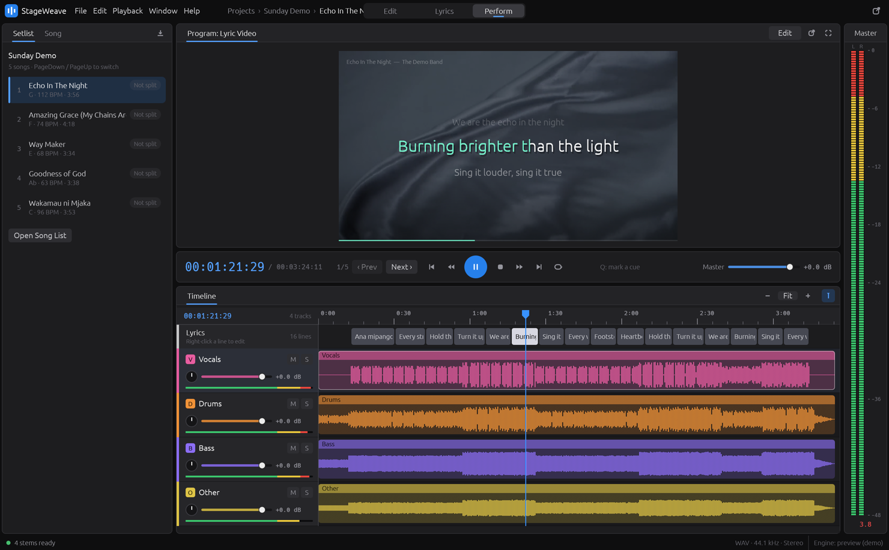
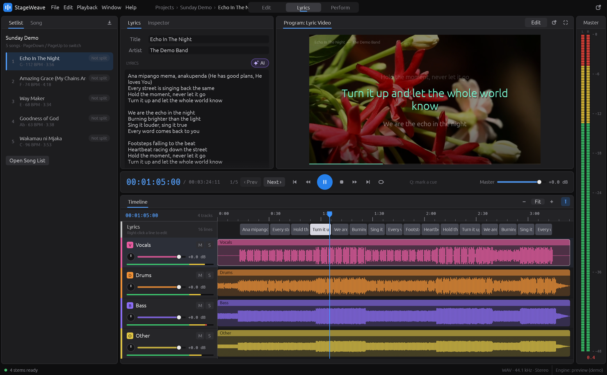
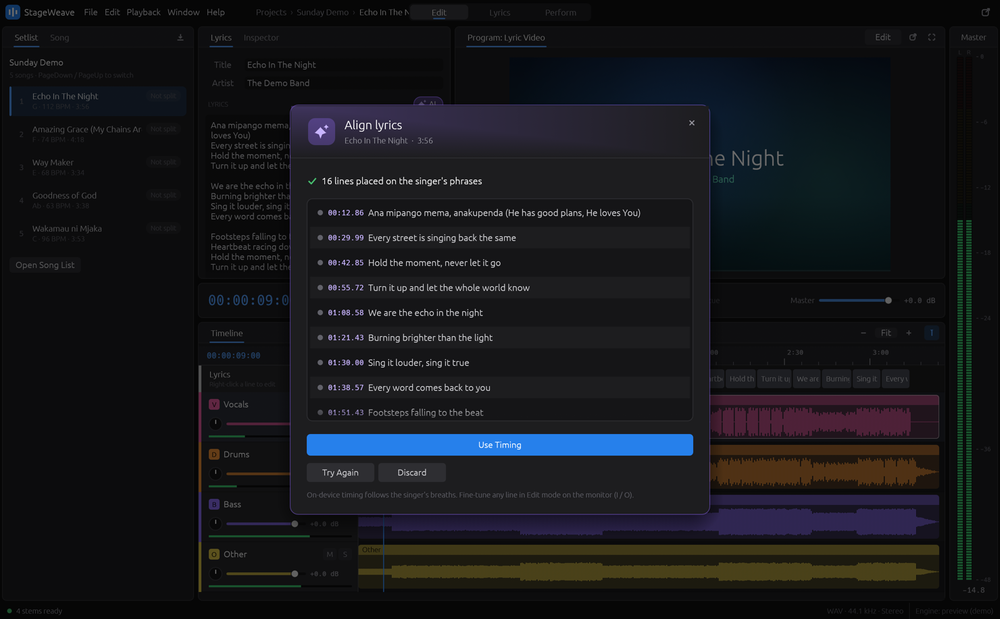

# StageWeave

A desktop app for worship teams and live music. Split any song into stems, mix them live, build sing-along lyric slides, and export lyric videos. It runs on macOS, Windows and Linux.



## Features

- **Setlists.** Make one project per service or event. Drop songs in, set the key, BPM and notes, and switch songs with PageUp / PageDown.
- **Search everything.** Press **⌘K** (Ctrl+K) to find any project or song across every setlist, by title, artist, key, notes or a line of the lyrics. You can also filter projects on Home or songs within a setlist.
- **Reuse songs.** **Add from Library…** brings a song from another setlist into this one, already split, with its lyrics, timing, cues and mix. Files are hard-linked where possible, so a song used in many setlists only takes up disk space once.
- **Stem splitting.** Separate vocals, drums, bass and other with Demucs, or karaoke and instrumental with UVR models. It all runs on your machine, and the engine installs itself the first time you split a song.
- **Live mixer.** Each stem has mute, solo, volume and pan, plus level meters and a master fader.
- **Cues.** While playing, press **Q** to mark the start of a section and **Q** again to loop it. Each cue keeps its own mix (for example, the chorus with drums muted). Exit it with **Esc**, the **Exit Cue** button, or by clicking elsewhere on the timeline.
- **Sections.** Press **S** where a part of the song starts and **S** again where it ends. Playback never stops: whenever the playhead is inside a section, that section's mix plays (for example, drums muted in the bridge, bass down in the verse), and the song's own mix comes back after it. Change mutes and volumes while the section plays, or right-click it in the **Sections** lane to rename it and set its mix. The mix switches on the exact sample, and lyric video exports follow it too.
- **Lyric slides.**
  - Karaoke-style highlighting, with an optional translation line.
  - Themes, text size, and "next line" and progress bar options.
  - A separate full-screen lyric window for the projector.
- **Motion backgrounds.**
  - Three starter loops are built in: Clouds, Flowers and Drapes.
  - You can also use your own image or short video loop.
  - A darken slider keeps the text readable.
- **Align (offline, word by word).** Click **Align** next to **Import…** to time the lyrics you pasted or imported to the singer, using the split vocals stem.
  - It runs on your computer with a local speech model (a one-time 122 MB download in **Window → Models**). No audio or lyrics are uploaded, and no API key is needed.
  - You get line and word timing, which you review before it's used: green lines matched clearly, amber lines need a check, grey lines weren't found in the singing. **Use Timing** can be undone with ⌘Z.
  - Sung parts that aren't in your lyrics, and lyrics that aren't sung, are handled without dragging the other lines off.
  - Limits: English only, and the model was trained on read speech, not singing. Long held notes, runs, backing vocals and ad-libs can confuse it, so check the result. Timing is per word, not per syllable.
- **AI lyrics (optional).**
  - Transcribe a song with Whisper (OpenAI or Groq), or align lyrics you already have to the singer's phrases.
  - Alignment can run fully on-device.
  - Transcription works phrase by phrase on the vocals stem, which helps a lot with non-English songs.
- **Import lyrics.** Click **Import…** next to **AI**, or drop a file on the song. Formats:
  - LRC, SRT and WebVTT keep their timing.
  - ChordPro, OpenLyrics / OpenLP, OpenSong and plain text are cleaned of chords and section labels, then timed automatically.
- **Lyric editing.**
  - Edit lines on the timeline or in a list, with full undo.
  - On the timeline, drag a line's left or right edge to change when it starts or ends, even when zoomed out. Where two lines touch, dragging the shared edge moves both; hold Alt to move only one. Word timing stretches to fit.
  - Drag a line to move it, or Alt-drag to drop a copy. Edges snap to the playhead, other lines, sections and cues; hold ⌘/Ctrl to turn snapping off.
  - Shift-click or ⌘/Ctrl-click to select several lines. Copy, cut and paste them with ⌘C / ⌘X / ⌘V. Pasting puts them at the playhead with their timing, even in another song.
  - **N** adds a line at the playhead. **E** stretches the previous line to the playhead.
  - Tap-sync lets you stamp lines live with Enter.
- **YouTube songs.** Click **Add YouTube…** (or paste a watch link on the setlist) to add a song from YouTube. StageWeave downloads the audio and a 720p video once, so it plays offline like any other song. Split the audio into stems like any other song. YouTube songs have a lyrics track too; until one is split, **Align** listens to the full mix instead of the vocals stem. The video plays behind the lyrics on the lyric window, in sync with the transport. Untick **Show the YouTube video** under Background to show just the lyrics on a background instead.
- **Slides.** Click **Add Slides…** or drop a PowerPoint (`.pptx`, `.ppt`), Keynote (`.key`) or OpenDocument (`.odp`) file on a setlist. A PDF or a set of images works too. Present with the arrow keys, PageUp / PageDown or a clicker; past the last slide it moves on to the next song. Videos and audio inside a `.pptx` play on their slide: autoplay media starts by itself, and other media plays when you click it or press Space. The lyric window shows the slides full screen.
- **Export lyric videos.** Render an MP4 (720p or 1080p, 25 or 30 fps) with the original audio or your current stem mix.
- **Phone remote.** Control StageWeave from a phone on the same Wi-Fi with the StageWeave Remote app ([`mobileapp/`](../mobileapp), Android APK on each release). Open a setlist, load a song, play, pause, go to the next item, loop cues, jump to sections, and mute, solo or turn up stems. Turn it on in **Settings → Phone remote**, then pick this computer in the app and enter the 4-digit code shown on screen. Only phones on your local network can connect.
- **Move projects between computers.** Export a project as a `.zip` (stems optional) and import it on another laptop, or just drop the zip on the window.

| Setlist | Perform |
| --- | --- |
|  |  |
| **Lyrics over a motion background** | **AI lyric alignment** |
|  |  |

## Install

Download the latest build from the [Releases](../../releases) page:

| Platform | File |
| --- | --- |
| macOS (Apple Silicon) | `StageWeave_<version>_aarch64.dmg` |
| macOS (Intel) | `StageWeave_<version>_x64.dmg` |
| Windows | `StageWeave_<version>_x64-setup.exe` |
| Debian / Ubuntu | `stageweave_<version>_amd64.deb` (`sudo apt install ./stageweave_*_amd64.deb`) |

The macOS builds aren't notarized yet. Drag StageWeave from the DMG into **Applications**, then, if macOS says the app "is damaged" or "can't be opened", run this in Terminal and open it again:

```sh
xattr -dr com.apple.quarantine /Applications/StageWeave.app
```

### What gets downloaded on first use

- **Separation engine.** The first split installs a private Python environment with PyTorch, Demucs and UVR (about 2 GB) into the app-data folder. Models are fetched when you first use them. You can manage them in **Window → Models**.
- **ffmpeg.** It's needed for video backgrounds and MP4 export. StageWeave uses the ffmpeg on your PATH if there is one, otherwise it downloads a static build once.
- **yt-dlp.** The first YouTube song downloads the standalone [yt-dlp](https://github.com/yt-dlp/yt-dlp) once. YouTube changes often, so update it from **Window → Models** if downloads stop working.
- **Slides.** PowerPoint, Keynote and OpenDocument files are converted with [LibreOffice](https://www.libreoffice.org) if it's installed (it isn't downloaded for you). Without it, export the deck as a PDF or images and add those. Pages are rendered with [PDFium](https://pdfium.googlesource.com/pdfium/), downloaded once (about 6 MB).

## Keyboard shortcuts

| Key | Action |
| --- | --- |
| Space | Play / pause |
| Home / End | Jump to start / end |
| ← / → | Nudge 5 seconds |
| L | Toggle loop |
| ⌘/Ctrl + K (or F) | Search all projects, songs and lyrics |
| Q | Mark a cue start, then close the cue and loop it |
| S | Mark a section start, then close it (it keeps playing with its own mix) |
| Esc | Exit the cue, or cancel marking a cue or section |
| N | New lyric line at the playhead (asks before replacing a line already there) |
| E | Stretch the previous lyric line to the playhead |
| Enter | Stamp a line (tap sync) |
| ⌘/Ctrl + C / X / V | Copy, cut, or paste the selected lyric lines (paste goes to the playhead) |
| ⌘/Ctrl + D | Duplicate the selected lyric lines |
| ⌘/Ctrl + A | Select every lyric line (once one is selected) |
| ⌘/Ctrl + Z | Undo (⇧⌘Z or ⌘Y to redo) |
| PageDown / PageUp | Next / previous song (works with foot pedals) |
| → / ↓ / PageDown, ← / ↑ / PageUp | Next / previous slide (in a slide deck) |
| Space | Play or pause the slide's video or audio, or go to the next slide |
| ⌘/Ctrl + scroll | Zoom the timeline |
| ⇧⌘P | Lyric window |
| F / double-click | Fullscreen lyric window |

## Where your data lives

| What | Where |
| --- | --- |
| Songs, stems, backgrounds | The workspace folder (default `~/Music/StageWeave`, change it in Settings) |
| Database, engine, models, API keys | The OS app-data folder, e.g. `~/Library/Application Support/com.CodeFamiliar.StageWeave` on macOS |

- **API keys** are stored in a private file that only your user account can read. They are never stored in the system keychain.
- **Coming from MusicKit?** Data from the app's former name is moved over automatically on first launch.

## Building from source

You need Rust (the version is pinned in `rust-toolchain.toml`; `rustup` picks it up automatically).

```sh
cargo run --release
cargo run --release -- --demo   # a sample setlist with mock audio; nothing touches your real data
cargo test
cargo clippy --all-targets
```

On Linux, install the audio and GUI development headers first:

```sh
sudo apt install pkg-config libasound2-dev libgtk-3-dev libxkbcommon-dev libxkbcommon-x11-dev \
  libxcb-render0-dev libxcb-shape0-dev libxcb-xfixes0-dev libwayland-dev libssl-dev
```

`src/dev.rs` lists the `STAGEWEAVE_*` environment variables used for development and for the screenshots in this README.

## Releasing

Pushing a tag that starts with `v` runs [`.github/workflows/release.yml`](.github/workflows/release.yml). It builds the .dmg, .exe and .deb packages and attaches them to a GitHub release. The tag must match the `version` in `Cargo.toml`:

```sh
git tag -a v0.1.0 -m "v0.1.0"
git push origin v0.1.0
```

## Credits

- **Starter backgrounds:** stock footage from [Mixkit](https://mixkit.co) under the Mixkit Stock Video Free License. See [`assets/backgrounds/CREDITS.md`](assets/backgrounds/CREDITS.md).
- **Separation:** [Demucs](https://github.com/adefossez/demucs) and [python-audio-separator](https://github.com/nomadkaraoke/python-audio-separator) (UVR models).
- **Lyrics alignment:** [wav2vec 2.0](https://arxiv.org/abs/2006.11477) `facebook/wav2vec2-base-960h` by Meta AI (Apache-2.0), as the int8 ONNX export [MixDirective/wav2vec2-base-960h-onnx](https://huggingface.co/MixDirective/wav2vec2-base-960h-onnx) (Apache-2.0; pinned revision, SHA-256 checked), run with [ONNX Runtime](https://onnxruntime.ai).
- **YouTube downloads:** [yt-dlp](https://github.com/yt-dlp/yt-dlp) (Unlicense).
- **Slides:** [LibreOffice](https://www.libreoffice.org) for conversion (if installed), and [PDFium](https://pdfium.googlesource.com/pdfium/) builds from [bblanchon/pdfium-binaries](https://github.com/bblanchon/pdfium-binaries) via [pdfium-render](https://github.com/ajrcarey/pdfium-render).
- **UI:** built with [egui](https://github.com/emilk/egui).
